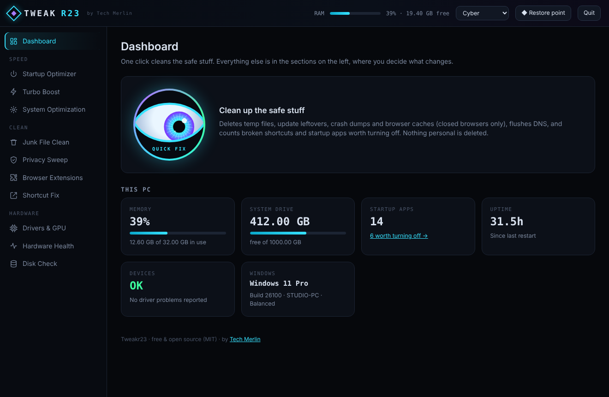
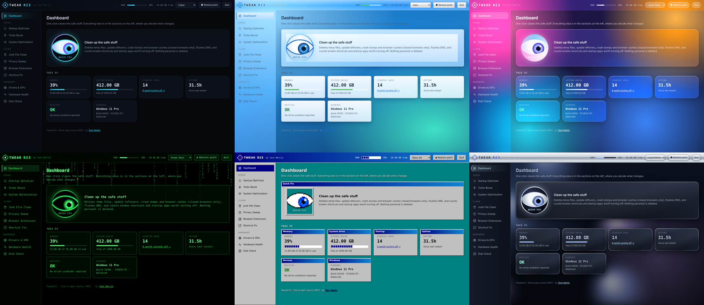
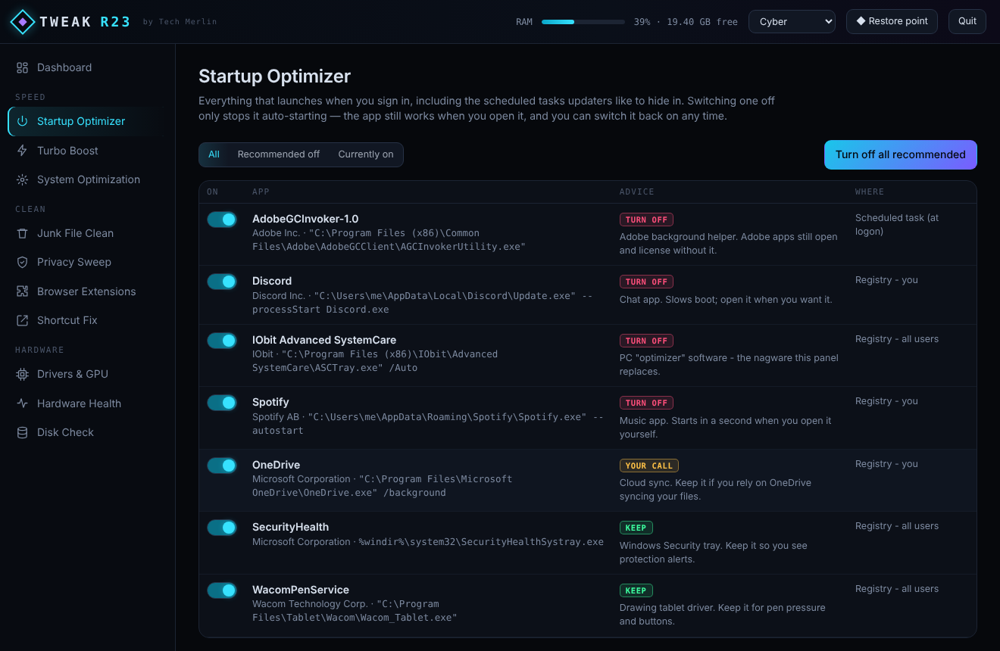
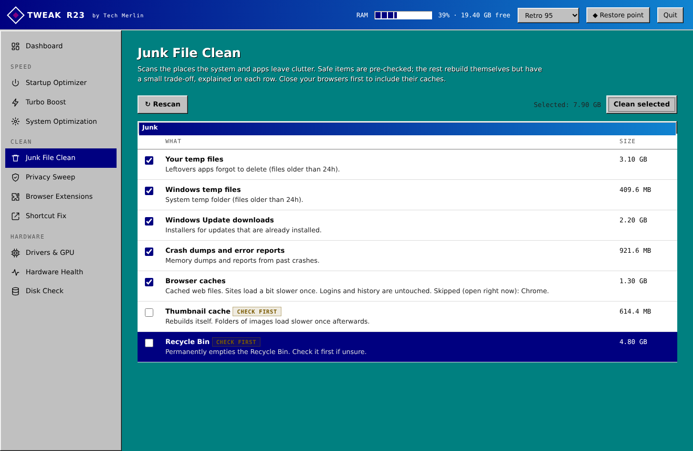
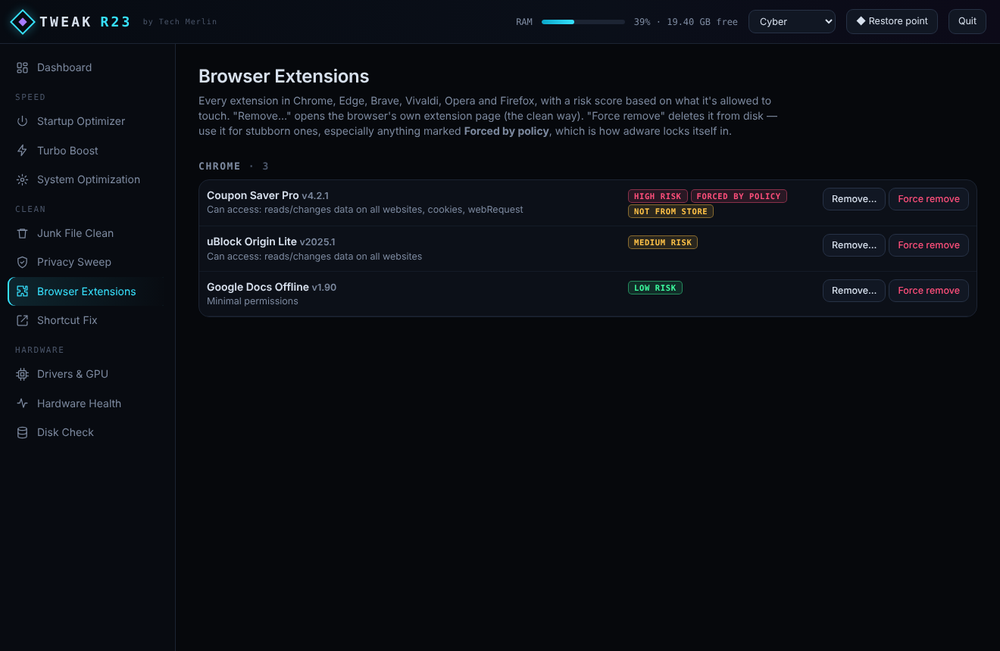

<div align="center">


# Tweakr23

**A light, honest tune-up panel for Windows and Ubuntu.**
One-click cleanup without the nagware: no installer, no tray icon, no upsells, no telemetry.

[](LICENSE)


by **[Tech Merlin](https://github.com/thetechmerlin)**



</div>

---

## Why

Most "PC optimizer" apps do a few useful things buried under pop-ups, fake "problems found" counters, and registry cleaners that do more harm than good. Tweakr23 keeps the useful parts, shows you exactly what it's going to change, and stays out of your way.

- **Tiny.** Windows: a batch file plus a PowerShell script. Linux: one Python script. Both share a single HTML interface.
- **Local only.** The engine listens on `localhost` with a random per-session token. Nothing leaves your machine. The only exception is the driver check, and only when you click it.
- **Nothing runs in the background.** Close the window and it's gone.
- **Reversible.** Startup changes can be toggled back on. Removed shortcuts go to the Recycle Bin or Trash. A one-click restore point (Windows) or Timeshift snapshot (Linux) sits in the top bar.

## Features

| | Windows | Ubuntu / Linux |
|---|---|---|
| ⚡ **Quick Fix** | Temp files, update leftovers, crash dumps, closed-browser caches, DNS flush, plus a summary of what else needs a look | `~/.cache`, `/tmp`, apt cache, old snap versions, old journal logs, DNS flush |
| 🚀 **Startup Optimizer** | Registry Run keys, Startup folders, logon scheduled tasks. Each entry gets a Keep / Your call / Turn off verdict with a reason | Startup Applications, your systemd user services, optional system services (CUPS, ModemManager, crash reporters…) |
| 🔥 **Turbo Boost** | Frees RAM by closing background apps. Windowed apps are asked politely so you still get "Save changes?" | Same, using a normal quit signal |
| 🧹 **Junk File Clean** | Scan → see sizes → choose. Safe items are pre-checked; trade-offs are explained on each row | Same |
| 🛡️ **Privacy Sweep** | Recent files, Run/Explorer history, clipboard, jump lists, browser history/cookies, plus switches for the advertising ID, Start menu ads, Bing in Start, activity history and telemetry | Recent files, shell history, clipboard, browser data, plus GNOME privacy switches, Ubuntu Pro apt ads and location services |
| 🧩 **Browser Extensions** | Chrome, Edge, Brave, Vivaldi, Opera, Firefox. Risk score from permissions; flags extensions **force-installed by policy** (an adware trick) | Same, including snap Chromium/Firefox and `/etc/*/policies` |
| 🔗 **Shortcut / Launcher Fix** | Broken desktop, Start menu and taskbar shortcuts | Broken `.desktop` launchers and dead symlinks |
| 🖥️ **Drivers & GPU** | Problem devices, driver ages, a **real Windows Update driver search**, vendor links, hardware-accelerated GPU scheduling | `lspci` drivers, devices with no driver, `ubuntu-drivers` and `fwupd` firmware checks |
| ❤️ **Hardware Health** | Drive health, wear, temperature and hours; battery capacity; RAM modules; crash and BSOD counts; top error sources | SMART via `smartctl`, battery, thermal zones, kernel errors and journal error sources |
| 💽 **Disk Check** | Online chkdsk scan, Fix now, Fix at restart | ext4 state, btrfs stats/scrub, SMART, check at next boot |
| ⚙️ **System Optimization** | Power plans (incl. Ultimate), TRIM/defrag, SFC + DISM, component cleanup, restart Explorer, rebuild icon cache, network reset, annoyance fixes (file extensions, classic right-click menu, "End task" on taskbar…) | Power profiles, TRIM, apt repair/upgrade, autoremove, Flatpak cleanup, recommended drivers, swappiness, GNOME tweaks |

### What it deliberately doesn't do

**Registry cleaning / defrag.** Windows already compacts its registry on its own, and "cleaning" it gives no measurable speed-up. It is also the #1 way optimizer apps break PCs. Tweakr23 offers a registry *backup* instead.

## Themes

Six built-in looks, switchable from the top bar. Your choice is remembered.



| Cyber | Aero | Liquid Glass | Green Rain | Retro 95 | Liquid Metal |
|---|---|---|---|---|---|
| Dark neon, the default | Glossy 2009 glass and gel buttons | Frosted translucent panes over color | Black and green with digital rain | Bevels, title bars, teal desktop, pixel eye | Y2K chrome with drifting mercury |

### The eye

The Quick Fix button is an eye that follows your cursor and blinks. While a scan runs, the pupil dilates and cycles through sacred geometry: **Seed of Life → Flower of Life → Metatron's Cube → Sri Yantra → Merkaba → Vesica Piscis → Tree of Life**. Its style changes to match each theme.


## Install & run

> Grab the code with **Code → Download ZIP** (or `git clone`) and keep the folder layout: the `windows/` and `linux/` engines load the shared `ui/` folder.

### Windows 10 / 11

1. Download and extract the ZIP. Before extracting, right-click the ZIP → **Properties** → tick **Unblock** if it's there.
2. Open `windows\` and double-click **`Tweakr23.bat`**. Accept the admin prompt.
3. The panel opens in its own window. The console window is the engine; closing it or pressing **Quit** stops everything.

**Desktop and Start menu shortcut (with the eye icon):** double-click `windows\Create-Shortcut.bat` once. If you move the folder later, run it again.

Requirements: nothing extra. It uses the PowerShell 5.1 and Edge that ship with Windows. If Edge is missing, it falls back to Chrome or your default browser.

### Ubuntu / Debian-based Linux

```bash
git clone https://github.com/thetechmerlin/Tweakr23.git
cd Tweakr23/linux
./install.sh        # adds Tweakr23 to your app menu (and optionally your desktop)
./tweakr23.sh       # or launch it from the app menu
```

The launcher asks for your password **once**, so it can clean the apt cache, read SMART data and toggle services. You can skip that, and those tools will then be limited. Don't run it with `sudo`.

Requirements: `python3` (preinstalled on Ubuntu). Optional extras that unlock more features:

```bash
sudo apt install smartmontools timeshift wl-clipboard
```

The panel opens in an app window if Chrome, Chromium, Brave, Edge or Vivaldi is installed; otherwise in your default browser. Built for GNOME on Ubuntu 22.04+, and works on most Debian/Ubuntu derivatives. Settings that don't exist on your desktop are hidden automatically.

## Screenshots

| Startup Optimizer | Junk File Clean (Retro 95) | Browser Extensions |
|---|---|---|
|  |  |  |

## How it works

```
Tweakr23/
├── ui/index.html          ← the whole interface: themes, eye, every view (shared)
├── windows/
│   ├── Tweakr23.bat       ← elevates to admin, starts the engine
│   ├── Tweakr23.ps1       ← PowerShell engine (HttpListener on localhost)
│   ├── Create-Shortcut.bat← desktop + Start menu shortcut with icon
│   └── tweakr23.ico
├── linux/
│   ├── tweakr23.sh        ← asks for sudo once, starts the engine
│   ├── tweakr23.py        ← Python engine (stdlib only)
│   └── install.sh         ← app-menu / desktop launcher
├── assets/                ← logo and icons
└── docs/screenshots/
```

Each engine starts a tiny HTTP server on `localhost` at a random port. It opens the UI in a chromeless app window that uses its own throwaway browser profile, so it never locks your real browser profile. Every API call needs a random token created for that session. The engine shuts itself down a few minutes after the window closes.

### Safety notes

- Junk cleaning never follows symlinks or junctions, skips files in use, and leaves user temp files younger than 24 hours.
- Browser data is only touched while that browser is closed. The engine detects its lock file.
- Windows system processes and your Linux desktop session are on a protected list Turbo Boost can't touch.
- Anything permanent (emptying the Recycle Bin/Trash, clearing cookies, network reset, boot-time disk check) asks first.
- Take a restore point or snapshot (top bar) before big changes. It's one click.

## Contributing

Issues and pull requests are welcome, especially:

- new entries for the startup advice rules (`$StartupRules` in `Tweakr23.ps1`, `STARTUP_RULES` in `tweakr23.py`)
- KDE / Xfce equivalents for the GNOME toggles
- new themes: add a `[data-theme=yourtheme]` block of CSS variables in `ui/index.html` and an `<option>` in the theme picker

Please keep it dependency-free and keep the "show, then ask" approach.

## License

[MIT](LICENSE) © 2026 [Tech Merlin](https://github.com/thetechmerlin). Free to use, modify and share.

Tweakr23 is an independent project and is not affiliated with Microsoft, Apple or Canonical. Theme names describe visual styles only.
